<!-- Cards are generated by scripts/render_cards.py from data/contributions.json; the workflow refreshes them daily. -->

<picture><source media="(prefers-color-scheme: dark)" srcset="cards/hero-dark.svg"></picture>

<a href="https://sudeepn1104.github.io/"><picture><source media="(prefers-color-scheme: dark)" srcset="cards/tile-portfolio-dark.svg"></picture></a> <a href="https://www.linkedin.com/in/sudeep-u-nayak-b69313374/"><picture><source media="(prefers-color-scheme: dark)" srcset="cards/tile-linkedin-dark.svg"></picture></a> <a href="mailto:sudeepnayak1104@gmail.com"><picture><source media="(prefers-color-scheme: dark)" srcset="cards/tile-email-dark.svg"></picture></a>

<picture><source media="(prefers-color-scheme: dark)" srcset="cards/monthly-dark.svg"></picture>

<a href="https://github.com/Sudeepn1104/MLOPs-Observatory"><picture><source media="(prefers-color-scheme: dark)" srcset="cards/repo-mlops-observatory-dark.svg"></picture></a>

<a href="https://github.com/Sudeepn1104/AdharaAI"><picture><source media="(prefers-color-scheme: dark)" srcset="cards/repo-adharaai-dark.svg"></picture></a>

<a href="https://github.com/Sudeepn1104/jalsetu-lite"><picture><source media="(prefers-color-scheme: dark)" srcset="cards/repo-jalsetu-lite-dark.svg"></picture></a>

<picture><source media="(prefers-color-scheme: dark)" srcset="cards/graph-dark.svg"></picture>
